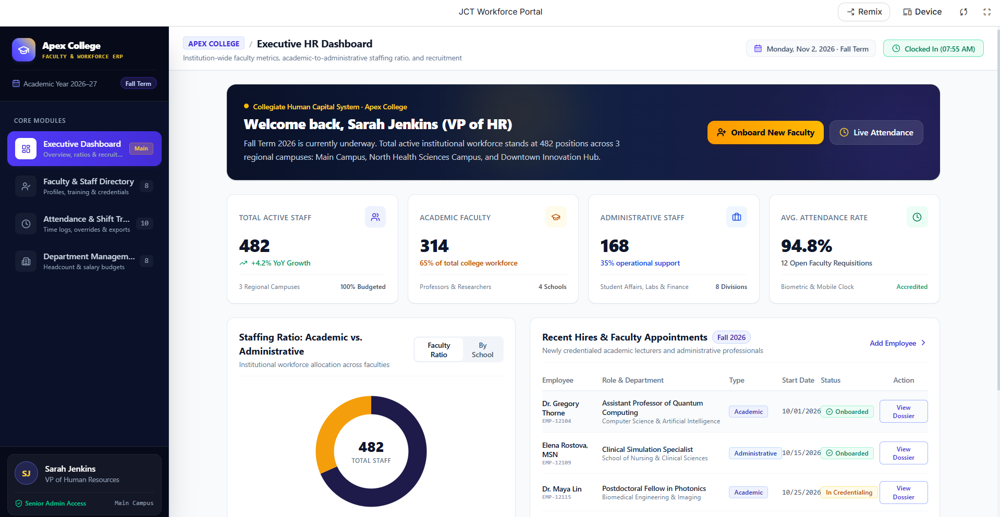
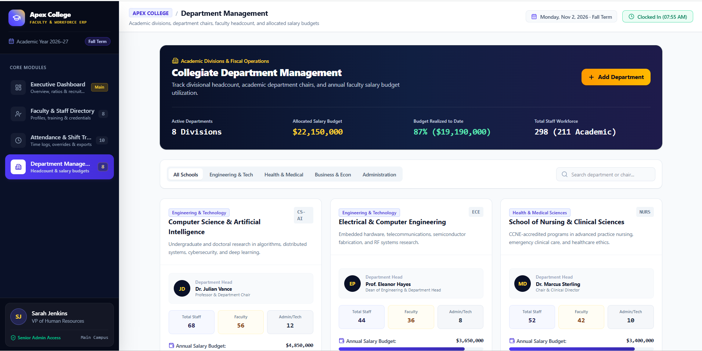
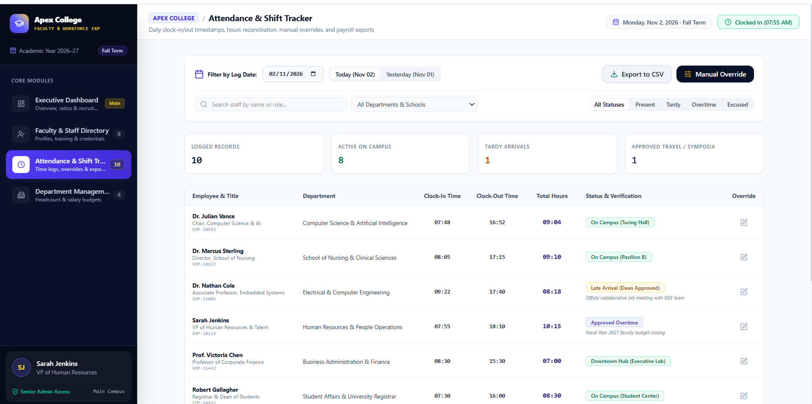
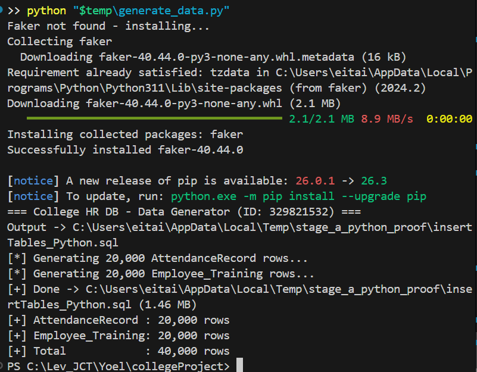
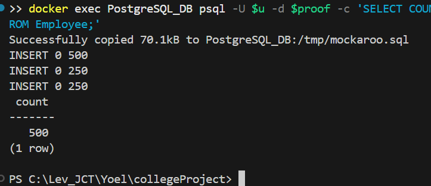
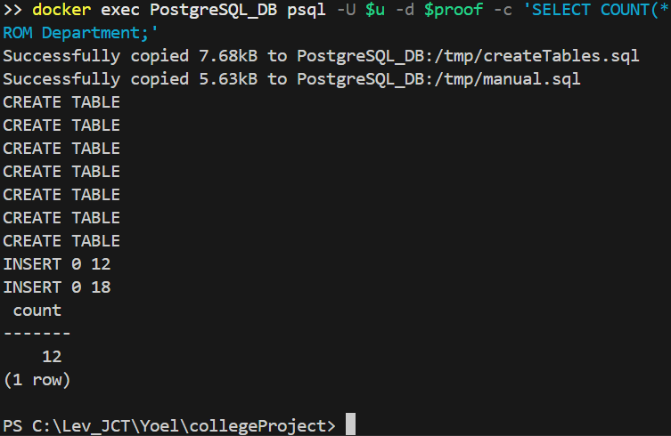
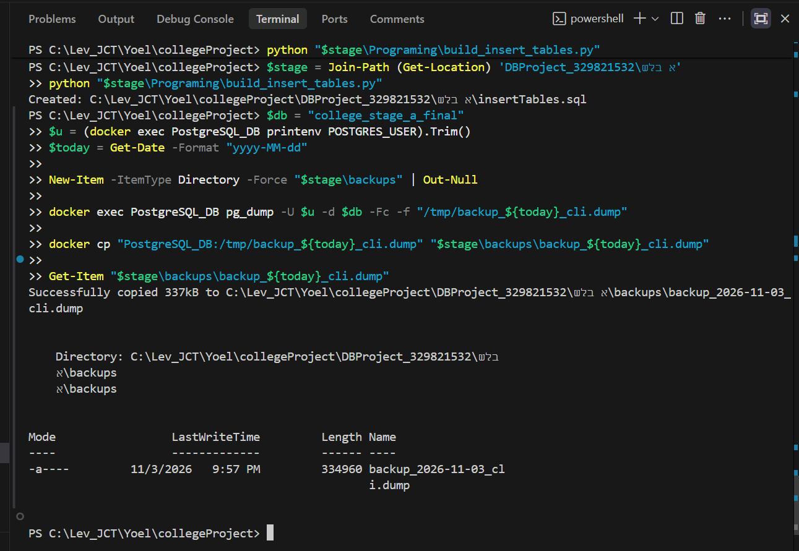

# דוח פרויקט מסדי נתונים — שלב א׳
## מערכת ניהול כוח אדם ומשאבי אנוש למכללה (College Manpower & HR Management System)

**סוג המוסד:** מכללה אקדמית (College)  
**קורס:** בסיסי נתונים (מסדי נתונים)  
**שמות המגישים:** יואל יקותיאל, איתי בן עמי  
**מזהה פרויקט:** `DBProject_1532_8415`  
**סביבת עבודה טכנולוגית:** PostgreSQL 17 / 16+, Docker Compose, pgAdmin 4, Python 3 (Faker), Mockaroo, Google AI Studio  
**תאריך הגשה:** נובמבר 2026  

---

## תוכן עניינים (Table of Contents)

1. [שער ומבוא למערכת](#1-שער-ומבוא-למערכת)
2. [אפיון מסכים וממשק משתמש (UI Mockups)](#2-אפיון-מסכים-וממשק-משתמש-ui-mockups)
3. [תרשימי מבנה הנתונים (ERD ו־DSD)](#3-תרשימי-מבנה-הנתונים-erd-וdsd)
4. [החלטות תכנון ונרמול (Design Decisions & 3NF)](#4-החלטות-תכנון-ונרמול-design-decisions--3nf)
5. [מילון הנתונים ומבנה הטבלאות](#5-מילון-הנתונים-ומבנה-הטבלאות)
6. [אכלוס הנתונים בשלוש שיטות (Data Population)](#6-אכלוס-הנתונים-בשלוש-שיטות-data-population)
7. [גיבוי ושחזור בסיס הנתונים (Backup & Restore)](#7-גיבוי-ושחזור-בסיס-הנתונים-backup--restore)
8. [הוראות הרצה ובדיקה מלאה (Execution Guide)](#8-הוראות-הרצה-ובדיקה-מלאה-execution-guide)
9. [מיפוי קובצי הפרויקט בתיקייה](#9-מיפוי-קובצי-הפרויקט-בתיקייה)

---

## 1. שער ומבוא למערכת

מערכת **ניהול כוח אדם למכללה** נועדה לנהל בצורה מרכזית, מדויקת ומנורמלת את כלל הפעילות התפעולית והאקדמית הקשורה לעובדי המכללה. 

המערכת מטפלת בארבעה צירים מרכזיים:
1. **ניהול זהות ומבנה העובדים:** ריכוז פרטי עובדים כלליים, חלוקה ברורה בין סגל אקדמי (חוקרים, מרצים, ראשי מעבדות, מסלולי קביעות) לבין סגל מנהלי (מנהלה, רכש, תפעול, דרגי ניהול).
2. **מבנה ארגוני ומחלקתי:** ניהול מחלקות אקדמיות ומנהליות, מעקב תקציבי מחלקתי ושיוך עובדים למחלקת האם.
3. **יומני נוכחות ושעון עבודה:** תיעוד יומי מפורט של כניסות ויציאות עובדים, תוך אימות תקינות שעות, ימי עבודה בישראל ומניעת אנומליות של זמנים.
4. **פיתוח מקצועי והדרכות:** מעקב אחר קורסי בטיחות, הכשרות פדגוגיות (כגון שימוש ב־Generative AI בהוראה), סמינרים מקצועיים וכתיבת הצעות מחקר תחרותיות (ISF, Horizon).

---

## 2. אפיון מסכים וממשק משתמש (UI Mockups)

במסגרת תכנון המערכת והבנת צורכי המשתמש, אופיינו ארבעה מסכי מפתח באב־טיפוס אינטראקטיבי שנבנה באמצעות **Google AI Studio**:

| שם המסך | תפקיד ופונקציונליות עיקרית | תצוגה מקדימה |
| :--- | :--- | :--- |
| **Dashboard** | לוח מחוונים ראשי למשאבי אנוש: התפלגות סגל, מדדי נוכחות ומעקב תקציבי |  |
| **Departments** | ניהול רשימת המחלקות, תקציב שנתי מוקצה ומספר אנשי הסגל המשויכים |  |
| **Staff Directory** | מאגר עובדים: סינון לפי סגל אקדמי/מנהלי, פרטי שכר ופרטי תפקיד |  |
| **Attendance** | שעון נוכחות ויומן מעקב דיווחי כניסה ויציאה של עובדים |  |

* **קישור לממשק החי ב־Google AI Studio:**  
  [פתיחת האפליקציה ב־Google AI Studio](https://ai.studio/apps/26c68d43-b8ed-48e8-93e4-edd17ac53a6a?fullscreenApplet=true)
* **קוד מקור של ה־Mockup:**  
  קוד הממשק (React + Vite + TypeScript) נשמר בתיקייה המקומית: [`UI_mockUp/`](UI_mockUp/).

---

## 3. תרשימי מבנה הנתונים (ERD ו־DSD)

### א. תרשים ישויות וקשרים (ERD — Entity Relationship Diagram)
התרשים מציג את שבע הישויות, מאפייניהן, קשרי ההיררכיה וההשתייכות, כולל התמחות הסגל וישות חלשה:


*קובץ מקור הניתן לעריכה ב־ERDPlus:* [`ERD&DSD/ERD_College.erdplus`](ERD%26DSD/ERD_College.erdplus)

### ב. תרשים סכמה פיזית ומפתחות (DSD — Data Structure Diagram)
מציג את הטבלאות הפיזיות, שמות השדות, סוגי הנתונים המדויקים ב־PostgreSQL, מפתחות ראשיים (PK), מפתחות זרים (FK) ומפתחות מורכבים:


*קובץ מקור הניתן לעריכה ב־ERDPlus:* [`ERD&DSD/DSD_College.erdplus`](ERD%26DSD/DSD_College.erdplus)

---

## 4. החלטות תכנון ונרמול (Design Decisions & 3NF)

### 1. מודל התמחות סגל (Supertype / Subtype Inheritance)
* **הבעיה:** לסגל אקדמי יש מאפיינים ייחודיים (תחום מחקר `ResearchField`, סטטוס קביעות `TenureStatus`), ואילו לסגל מנהלי יש מאפיינים שונים לחלוטין (מיקום משרד `OfficeNumber`, דרגת ניהול `ManagementLevel`). שמירת כל המאפיינים בטבלה יחידה הייתה גורמת לעמודות רבות המכילות `NULL` (אנטי־דפוס בבסיסי נתונים).
* **הפתרון:** יישום תבנית **Table-per-Type (TPT)**.
  - טבלת האב `Employee` מחזיקה את השדות המשותפים לכלל העובדים (`EmployeeID`, `FirstName`, `LastName`, `ID_Number`, `HireDate`, `BaseSalary`, `DepartmentID`, `EmployeeType`).
  - טבלאות הבן `AdministrativeStaff` ו־`AcademicStaff` מקושרות לטבלת האב באמצעות מפתח ראשי שהוא בו־זמנית מפתח זר (`EmployeeID`) עם אילוץ `ON DELETE CASCADE`.
  - תכנון זה שומר על עקרון האחריות היחידה ומאפשר אילוצי `NOT NULL` על שדות התמחות.

### 2. ישות חלשה לדיווחי נוכחות (Weak Entity)
* **הסבר:** רשומת נוכחות בטבלה `AttendanceRecord` אינה בעלת משמעות עצמאית ללא העובד שאליו היא שייכת (קיומה תלוי לחלוטין בעובד).
* **מפתח ראשי מורכב:** `(EmployeeID, RecordID)`. מספר הרשומה (`RecordID`) הוא מזהה פנימי/מבדיל (Discriminator) עבור אותו עובד, בעוד `EmployeeID` משמש כחלק מהמפתח הראשי וכמפתח זר ל־`Employee` עם תלות `ON DELETE CASCADE`.

### 3. קשר רבים־לרבים לקורסים והדרכות (M:N Junction Table)
* **הסבר:** עובד יכול להשתתף בקורסי הכשרה מרובים במהלך שנות עבודתו, וכל קורס מועבר למשתתפים רבים. יתרה מזאת, עובד עשוי לעבור ריענון לאותו קורס בשנים עוקבות.
* **מפתח ראשי מורכב:** `(EmployeeID, CourseID, CompletionDate)`. הכללת תאריך הסיום (`CompletionDate`) במפתח הראשי מאפשרת תיעוד של אותו עובד באותו קורס במועדי השלמה שונים.

### 4. עמידה בכללי נרמול (3NF)
* **1NF:** כל העמודות מכילות ערכים אטומיים בלבד; אין רשימות מופרדות בפסיקים או קבוצות חוזרות.
* **2NF:** כל השדות שאינם חלק מהמפתח תלויים באופן מלא במפתח הראשי כולו (בטבלאות בעלות מפתח מורכב אין תלות חלקית).
* **3NF:** אין תלויות טרנזיטיביות בין שדות שאינם מפתחות (למשל, פרטי מחלקה ותקציבה שמורים אך ורק ב־`Department` ולא משוכפלים אצל העובד).

---

## 5. מילון הנתונים ומבנה הטבלאות

הסכמה כוללת 7 טבלאות מנורמלות:

| שם הטבלה | מהות הטבלה | מפתח ראשי (PK) | מפתחות זרים (FK) | אילוצים מרכזיים |
| :--- | :--- | :--- | :--- | :--- |
| **Department** | מחלקות המכללה | `DepartmentID` | אין | `Budget >= 0`, `UNIQUE(DepartmentName)` |
| **TrainingCourse** | קטלוג קורסי הכשרה | `CourseID` | אין | `UNIQUE(CourseName)` |
| **Employee** | ישות־על לכלל עובדי המכללה | `EmployeeID` | `DepartmentID` -> Department | `LENGTH(ID_Number) = 9`, `BaseSalary >= 0`, `HireDate <= CURRENT_DATE` |
| **AdministrativeStaff** | תת־סוג: סגל מנהלי | `EmployeeID` | `EmployeeID` -> Employee | `ManagementLevel IN ('Entry', 'Junior', ...)` |
| **AcademicStaff** | תת־סוג: סגל אקדמי | `EmployeeID` | `EmployeeID` -> Employee | `TenureStatus IN ('Tenured', 'Tenure-Track', ...)` |
| **AttendanceRecord** | ישות חלשה: דיווחי נוכחות | `(EmployeeID, RecordID)` | `EmployeeID` -> Employee | `WorkDate <= CURRENT_DATE`, `ClockOutTime >= ClockInTime` |
| **Employee_Training** | טבלת קשר M:N: השלמת קורסים | `(EmployeeID, CourseID, CompletionDate)` | `EmployeeID` -> Employee,<br>`CourseID` -> Course | `CompletionDate <= CURRENT_DATE` |

* **מילון נתונים מפורט ומלא:** ראו קובץ [`Data_Dictionary.md`](Data_Dictionary.md).
* **סקריפט יצירת הטבלאות:** ראו קובץ [`createTables.sql`](createTables.sql).
* **סקריפט מחיקת הטבלאות בסדר הפוך:** ראו קובץ [`dropTables.sql`](dropTables.sql).

---

## 6. אכלוס הנתונים בשלוש שיטות (Data Population)

על פי דרישות ההנחיות לשלב א׳, הנתונים נוצרו ואוכלסו ב־**3 שיטות שונות לחלוטין**, ובנוסף הורחבו לכמות מספקת (מעל 500 בכל טבלה ומעל 20,000 בשתיים מהן):

```
                                  [ שיטות אכלוס הנתונים ]
                                             │
         ┌───────────────────────────────────┼───────────────────────────────────┐
         │                                   │                                   │
      שיטה 1:                             שיטה 2:                             שיטה 3:
   Python + Faker                         Mockaroo                           SQL ידני
         │                                   │                                   │
  20,000 Attendance                   500 Employees                       12 Departments
  20,000 Training                     250 Administrative Staff            18 Training Courses
                                      250 Academic Staff
```

### פירוט שלוש השיטות:
1. **שיטה 1 — תסריט Python וספריית Faker:**
   - קובץ: [`Programing/generate_data.py`](Programing/generate_data.py) -> יוצר את [`Programing/insertTables_Python.sql`](Programing/insertTables_Python.sql).
   - מייצר **20,000 רשומות** ל־`AttendanceRecord` (חלוקה לפי שבועות עבודה בישראל ראשון־חמישי, שעות עבודה הגיוניות) ו־**20,000 רשומות** ל־`Employee_Training`.
2. **שיטה 2 — מחולל Mockaroo:**
   - תיקייה: [`mockarooFiles/`](mockarooFiles/) (כולל קובץ הסכמות [`mockaroo_schemas.json`](mockarooFiles/mockaroo_schemas.json) והוראות ב־[`mockaroo_instructions.md`](mockarooFiles/mockaroo_instructions.md)).
   - מייצר **500 עובדים** ב־`Employee`, **250 רשומות** ב־`AdministrativeStaff` ו־**250 רשומות** ב־`AcademicStaff`.
3. **שיטה 3 — פקודות SQL ישירות (ידניות):**
   - קובץ: [`DataImportFiles/insertTables_Manual.sql`](DataImportFiles/insertTables_Manual.sql).
   - מייצר **12 מחלקות ריאליסטיות** של המכללה ו־**18 קורסי הדרכה** פדגוגיים ותעשייתיים.
4. **השלמה כמותית מלאה:**
   - קובץ [`insertTables_Extra.sql`](insertTables_Extra.sql) משלים את יתרת השורות הנדרשות בטבלאות התשתית לכדי מעל 500 שורות.
   - קובץ [`insertTables.sql`](insertTables.sql) הוא הקובץ המאוחד המכיל את כלל הפקודות.

### צילומי מסך מהרצת שלוש שיטות האכלוס:

| שיטה 1: Python & Faker | שיטה 2: Mockaroo | שיטה 3: פקודות SQL ידניות |
| :---: | :---: | :---: |
|  |  |  |

### ספירת שורות סופית במסד הנתונים (בדיקת audit.sql):

| שם הטבלה | דרישת מינימום | כמות בפועל | סטטוס |
| :--- | :--- | :--- | :---: |
| `Department` | $\ge 500$ | **500** | מאוכלס ותקין |
| `TrainingCourse` | $\ge 500$ | **500** | מאוכלס ותקין |
| `Employee` | $\ge 500$ | **1,000** | מאוכלס ותקין |
| `AdministrativeStaff` | $\ge 500$ (יחד עם סגל אקדמי) | **500** | מאוכלס ותקין |
| `AcademicStaff` | $\ge 500$ (יחד עם סגל מנהלי) | **500** | מאוכלס ותקין |
| `AttendanceRecord` | $\ge 20,000$ | **20,000** | מאוכלס ותקין |
| `Employee_Training` | $\ge 20,000$ | **20,000** | מאוכלס ותקין |
| **סה"כ רשומות במסד** | $\ge 42,000$ | **43,000** | **עמידה מלאה בדרישות** |

---

## 7. גיבוי ושחזור בסיס הנתונים (Backup & Restore)

בסיס הנתונים גובה בשתי השיטות המקובלות בפורמט `Custom` (`.dump`):

| סוג גיבוי | מיקום הקובץ בפרויקט | אופן הביצוע |
| :--- | :--- | :--- |
| **CLI (שורת הפקודה)** | [`backups/backup_2026-11-03_cli.dump`](backups/backup_2026-11-03_cli.dump) | פקודת `pg_dump -U postgres -F c` מתוך הקונטיינר |
| **GUI (ממשק pgAdmin)** | [`backups/backup_2026-11-03_ui.dump`](backups/backup_2026-11-03_ui.dump) | תפריט Backup בממשק pgAdmin 4 |

### צילומי מסך של תהליך הגיבוי:

| גיבוי משורת הפקודה (Docker CLI) | אישור גיבוי בממשק pgAdmin 4 |
| :---: | :---: |
|  |  |

### בדיקת שחזור אצל השותף (PostgreSQL 17):
קובץ הגיבוי הועבר למחשב של השותף ושוחזר בהצלחה מלאה. כל שבע הטבלאות וכל 43,000 הרשומות עלו בצורה תקינה:


---

## 8. הוראות הרצה ובדיקה מלאה (Execution Guide)

להרצה מלאה של שלב א׳ על גבי מסד נתונים חדש ונקי:

```powershell
# 1. ניווט לתיקיית שלב א'
cd "C:\Users\yoelm\source\repos\DBProject\.git\collegeProject\DBProject_1532_8415\שלב א"

# 2. בניית קובץ האכלוס המאוחד (במידת הצורך)
python "Programing\build_insert_tables.py"

# 3. יצירת מסד בדיקה ייעודי
docker exec PostgreSQL_DB createdb -U postgres college_stage_a_verify

# 4. העתקת קובצי ה-SQL לקונטיינר
docker cp createTables.sql PostgreSQL_DB:/tmp/createTables.sql
docker cp insertTables.sql PostgreSQL_DB:/tmp/insertTables.sql
docker cp selectAll.sql PostgreSQL_DB:/tmp/selectAll.sql
docker cp audit.sql PostgreSQL_DB:/tmp/audit.sql

# 5. יצירת הטבלאות, אכלוס ובדיקת שורות
docker exec PostgreSQL_DB psql -v ON_ERROR_STOP=1 -U postgres -d college_stage_a_verify -f /tmp/createTables.sql
docker exec PostgreSQL_DB psql -v ON_ERROR_STOP=1 -U postgres -d college_stage_a_verify -f /tmp/insertTables.sql
docker exec PostgreSQL_DB psql -v ON_ERROR_STOP=1 -U postgres -d college_stage_a_verify -f /tmp/audit.sql
```

לבדיקה מהירה של שליפת נתונים, הריצו את [`selectAll.sql`](selectAll.sql).  
למחיקת הטבלאות בסדר תלויות תקין, הריצו את [`dropTables.sql`](dropTables.sql).

---

## 9. מיפוי קובצי הפרויקט בתיקייה

```
DBProject_1532_8415/שלב א/
├── README.md                      # מסמך זה — דוח שלב א' המלא והמפורט
├── createTables.sql               # סקריפט DDL ליצירת 7 הטבלאות והאילוצים (3NF)
├── dropTables.sql                 # סקריפט מחיקת טבלאות בסדר תלויות הפוך
├── insertTables.sql               # סקריפט אכלוס מאוחד ומלא (43,000 שורות)
├── insertTables_Extra.sql         # השלמות שורות מעבר לבסיס
├── selectAll.sql                  # שאילתות בדיקה ושליפה מדגמית
├── audit.sql                      # שאילתת ספירת שורות לפי טבלה
├── Data_Dictionary.md             # מילון נתונים מפורט בעברית/אנגלית
├── backups/                       # קובצי הגיבוי הרשמיים (CLI ו-UI)
│   ├── backup_2026-11-03_cli.dump
│   └── backup_2026-11-03_ui.dump
├── DataImportFiles/               # שיטה 3 — אכלוס ידני
│   └── insertTables_Manual.sql
├── mockarooFiles/                 # שיטה 2 — אכלוס באמצעות Mockaroo
│   ├── insertTables_Mockaroo.sql
│   ├── mockaroo_instructions.md
│   └── mockaroo_schemas.json
├── Programing/                    # שיטה 1 — אכלוס באמצעות Python
│   ├── build_insert_tables.py
│   ├── generate_data.py
│   ├── insertTables_Python.sql
│   └── requirements.txt
├── ERD&DSD/                       # תרשימי המודל
│   ├── ERD_College.erdplus
│   ├── ERD_image.png
│   ├── DSD_College.erdplus
│   └── DSD_image.png
└── UI_mockUp/                     # קוד מקור מלא של אב-הטיפוס לממשק (React)
```
