# דוח פרויקט מסדי נתונים — שלב ב׳

[חזרה לסיכום הפרויקט](../../README.md)
## שאילתות, אילוצים, טרנזקציות ואינדקסים

**מערכת:** מערכת ניהול כוח אדם ומשאבי אנוש למכללה (College Manpower & HR Management System)  
**שמות המגישים:** יואל יקותיאל, איתי בן עמי  
**מזהה פרויקט:** `DBProject_1532_8415`  
**סביבת עבודה:** PostgreSQL, Docker Compose, pgAdmin 4  

---

## תוכן עניינים

1. [מבוא והתאמה למסכי המערכת](#1-מבוא-והתאמה-למסכי-המערכת)
2. [שאילתות SELECT בשתי צורות (Q1–Q4)](#2-שאילתות-select-בשתי-צורות-q1q4)
3. [שאילתות SELECT נוספות (Q5–Q8)](#3-שאילתות-select-נוספות-q5q8)
4. [שאילתות DELETE (D1–D3)](#4-שאילתות-delete-d1d3)
5. [שאילתות UPDATE (U1–U3)](#5-שאילתות-update-u1u3)
6. [טרנזקציות: ROLLBACK ו־COMMIT](#6-טרנזקציות-rollback-וcommit)
7. [אילוצים (Constraints)](#7-אילוצים-constraints)
8. [אינדקסים (Indexes)](#8-אינדקסים-indexes)
9. [קבצי השלב](#9-קבצי-השלב)

---

## 1. מבוא והתאמה למסכי המערכת

בשלב זה ביצענו תשאול מתקדם של בסיס הנתונים שנבנה ואוכלס בשלב א׳. כל השאילתות תוכננו כך שיתאימו לארבעת המסכים שהוגדרו במערכת:

| מסך | שאילתות משויכות |
|---|---|
| **Dashboard** | Q1 (סיכום נוכחות חודשי לפי מחלקה) |
| **Departments** | Q4 (ניצול תקציב מול שכר), Q8 (מנהלים בכירים ומספר כפופים), U3 (עדכון תקציב) |
| **Staff** | Q2 (מצטייני השתלמויות ב־2025), Q5 (סגל אקדמי קבוע ותיק), Q6 (קורסים מובילים לפי שנה/חודש), D2, D3, U1, U2 |
| **Attendance** | Q3 (עובדים ללא נוכחות ב־3 החודשים האחרונים), Q7 (שעות נוספות מעל ממוצע המכללה ב־2026), D1 |

השאילתות משלבות צירופים (`JOIN`) של מספר טבלאות, תתי־שאילתות, שאילתות מקוננות, `GROUP BY`, `HAVING`, `ORDER BY`, ופירוק שדות תאריך לשנה, חודש ויום באמצעות `EXTRACT` ו־`AGE`.

קוד מלא של כל השאילתות: [`Queries.sql`](Queries.sql)

---

## 2. שאילתות SELECT בשתי צורות (Q1–Q4)

### Q1 — סיכום נוכחות חודשי לפי מחלקה (מסך Dashboard)

**תיאור השאילתה:** מחשבת עבור כל מחלקה, בכל שנה וחודש, את מספר העובדים השונים שהתייצבו לעבודה, סך המשמרות שבוצעו, וממוצע שעות המשמרת. השאילתה מפרקת את שדה התאריך (`WorkDate`) לשנה וחודש ומאפשרת למנהלי משאבי האנוש לעקוב אחר מגמות נוכחות בלוח המחוונים.

#### צורה א׳ — JOIN ישיר וקיבוץ:
```sql
SELECT
    d.DepartmentName,
    EXTRACT(YEAR  FROM a.WorkDate)::INT   AS WorkYear,
    EXTRACT(MONTH FROM a.WorkDate)::INT   AS WorkMonth,
    COUNT(DISTINCT a.EmployeeID)          AS EmployeeCount,
    COUNT(a.RecordID)                     AS TotalShifts,
    ROUND(
        AVG(
            EXTRACT(EPOCH FROM (a.ClockOutTime - a.ClockInTime)) / 3600.0
        )::NUMERIC, 2
    )                                     AS AvgShiftHours
FROM AttendanceRecord a
JOIN Employee         e ON a.EmployeeID    = e.EmployeeID
JOIN Department       d ON e.DepartmentID  = d.DepartmentID
GROUP BY d.DepartmentName,
         EXTRACT(YEAR  FROM a.WorkDate),
         EXTRACT(MONTH FROM a.WorkDate)
ORDER BY d.DepartmentName,
         WorkYear,
         WorkMonth;
```


**צילום תוצאה — עד 5 שורות (Q1 צורה א׳)**

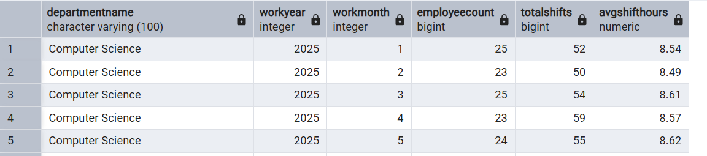


#### צורה ב׳ — תת־שאילתה באמצעות CTE (`WITH`):
```sql
WITH MonthlyStats AS (
    SELECT
        e.DepartmentID,
        EXTRACT(YEAR  FROM a.WorkDate)::INT AS WorkYear,
        EXTRACT(MONTH FROM a.WorkDate)::INT AS WorkMonth,
        COUNT(DISTINCT a.EmployeeID)        AS EmployeeCount,
        COUNT(a.RecordID)                   AS TotalShifts,
        ROUND(
            AVG(
                EXTRACT(EPOCH FROM (a.ClockOutTime - a.ClockInTime)) / 3600.0
            )::NUMERIC, 2
        )                                   AS AvgShiftHours
    FROM AttendanceRecord a
    JOIN Employee e ON a.EmployeeID = e.EmployeeID
    GROUP BY e.DepartmentID,
             EXTRACT(YEAR  FROM a.WorkDate),
             EXTRACT(MONTH FROM a.WorkDate)
)
SELECT
    d.DepartmentName,
    ms.WorkYear,
    ms.WorkMonth,
    ms.EmployeeCount,
    ms.TotalShifts,
    ms.AvgShiftHours
FROM MonthlyStats ms
JOIN Department d ON ms.DepartmentID = d.DepartmentID
ORDER BY d.DepartmentName, ms.WorkYear, ms.WorkMonth;
```


**צילום תוצאה — עד 5 שורות (Q1 צורה ב׳)**

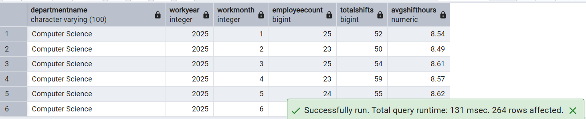


**השוואת יעילות (Q1):**  
בצורה ב׳ האגרגציה מתבצעת תחילה לפי `DepartmentID` (מזהה מספרי `INTEGER`) על גבי 20,000 רשומות הנוכחות, ורק לאחר צמצום התוצאה ל־264 שורות מתבצע ה־`JOIN` לטבלת `Department` לצורך שליפת שם המחלקה. לעומת זאת, בצורה א׳ ה־`JOIN` לשלוש הטבלאות מתבצע על כל 20,000 השורות לפני הקיבוץ, והקיבוץ נעשה על מחרוזת (`DepartmentName`). לכן **צורה ב׳ יעילה יותר** מבחינת כמות הנתונים שעוברת בצירוף ומבחינת עלות הגיבוב/מיון על מפתח שלם במקום מחרוזת.

---

### Q2 — עובדים שהשלימו ב־2025 יותר השתלמויות מהממוצע של אותה שנה (מסך Staff)

**תיאור השאילתה:** מאתרת את העובדים הפעילים ביותר בלמידה והכשרות בשנת 2025 — מציגה מזהה עובד, שם מלא, מחלקה, סוג סגל ומספר הקורסים שהשלימו ב־2025, עבור עובדים שמספר הקורסים שלהם גבוה מממוצע הקורסים לעובד באותה שנה.
#### צורה א׳ — תת־שאילתה ב־`HAVING`:
```sql
SELECT
    e.EmployeeID,
    e.FirstName,
    e.LastName,
    d.DepartmentName,
    e.EmployeeType,
    COUNT(et.CourseID) AS CourseCount2025
FROM Employee e
JOIN Department        d  ON e.DepartmentID = d.DepartmentID
JOIN Employee_Training et ON e.EmployeeID   = et.EmployeeID
WHERE EXTRACT(YEAR FROM et.CompletionDate) = 2025
GROUP BY e.EmployeeID, e.FirstName, e.LastName, d.DepartmentName, e.EmployeeType
HAVING COUNT(et.CourseID) > (
    SELECT AVG(course_count)
    FROM (
        SELECT COUNT(CourseID) AS course_count
        FROM Employee_Training
        WHERE EXTRACT(YEAR FROM CompletionDate) = 2025
        GROUP BY EmployeeID
    ) sub
)
ORDER BY CourseCount2025 DESC, e.LastName;
```


**צילום תוצאה — עד 5 שורות (Q2 צורה א׳)**

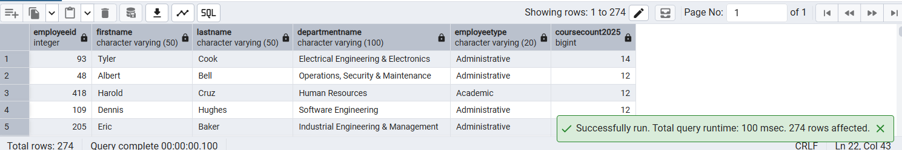


#### צורה ב׳ — טבלה נגזרת (Derived Table) ב־`FROM` + `CROSS JOIN` לממוצע:
```sql
SELECT
    e.EmployeeID,
    e.FirstName,
    e.LastName,
    d.DepartmentName,
    e.EmployeeType,
    ec.CourseCount2025
FROM (
    SELECT EmployeeID, COUNT(CourseID) AS CourseCount2025
    FROM Employee_Training
    WHERE EXTRACT(YEAR FROM CompletionDate) = 2025
    GROUP BY EmployeeID
) ec
JOIN Employee   e ON ec.EmployeeID   = e.EmployeeID
JOIN Department d ON e.DepartmentID  = d.DepartmentID
CROSS JOIN (
    SELECT AVG(CourseCount2025) AS AvgCourses FROM (
        SELECT COUNT(CourseID) AS CourseCount2025
        FROM Employee_Training
        WHERE EXTRACT(YEAR FROM CompletionDate) = 2025
        GROUP BY EmployeeID
    ) sub
) avg_sub
WHERE ec.CourseCount2025 > avg_sub.AvgCourses
ORDER BY ec.CourseCount2025 DESC, e.LastName;
```


**צילום תוצאה — עד 5 שורות (Q2 צורה ב׳)**

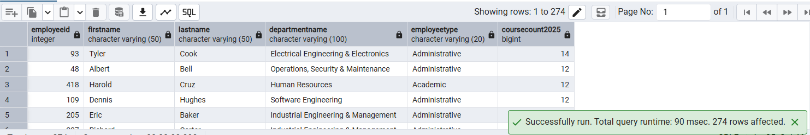


**השוואת יעילות (Q2):**  
**צורה ב׳ יעילה יותר** (90ms לעומת 100ms בצורה א׳). בצורה א׳ מצרפים את כל שורות ההשתלמות של 2025 לטבלאות `Employee` ו־`Department` **לפני** הקיבוץ, ומבצעים `GROUP BY` על חמש עמודות (כולל שלוש עמודות טקסט). בצורה ב׳ מקבצים תחילה את `Employee_Training` לפי `EmployeeID` (מפתח מספרי בלבד), ורק את התוצאה המצומצמת מצרפים לעובדים ולמחלקות.

---

### Q3 — עובדים ללא נוכחות ב־3 החודשים האחרונים (מסך Attendance)

**תיאור השאילתה:** מאתרת עובדים שלא דיווחו אף משמרת בשלושת החודשים האחרונים, כולל פירוק תאריך הקליטה לשנה וחודש. מיועדת למסך הנוכחות לצורך זיהוי עובדים בחופשה ממושכת או לא פעילים.

#### צורה א׳ — שימוש ב־`NOT IN`:
```sql
SELECT
    e.EmployeeID,
    e.FirstName,
    e.LastName,
    d.DepartmentName,
    e.HireDate,
    EXTRACT(YEAR  FROM e.HireDate)::INT AS HireYear,
    EXTRACT(MONTH FROM e.HireDate)::INT AS HireMonth
FROM Employee e
JOIN Department d ON e.DepartmentID = d.DepartmentID
WHERE e.EmployeeID NOT IN (
    SELECT DISTINCT EmployeeID
    FROM AttendanceRecord
    WHERE WorkDate >= CURRENT_DATE - INTERVAL '3 months'
)
ORDER BY e.LastName, e.FirstName;
```


**צילום תוצאה — עד 5 שורות (Q3 צורה א׳)**

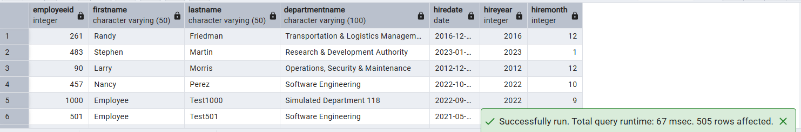


#### צורה ב׳ — שימוש ב־`NOT EXISTS` (תת־שאילתה מתואמת):
```sql
SELECT
    e.EmployeeID,
    e.FirstName,
    e.LastName,
    d.DepartmentName,
    e.HireDate,
    EXTRACT(YEAR  FROM e.HireDate)::INT AS HireYear,
    EXTRACT(MONTH FROM e.HireDate)::INT AS HireMonth
FROM Employee e
JOIN Department d ON e.DepartmentID = d.DepartmentID
WHERE NOT EXISTS (
    SELECT 1
    FROM AttendanceRecord a
    WHERE a.EmployeeID = e.EmployeeID
      AND a.WorkDate >= CURRENT_DATE - INTERVAL '3 months'
)
ORDER BY e.LastName, e.FirstName;
```


**צילום תוצאה — עד 5 שורות (Q3 צורה ב׳)**

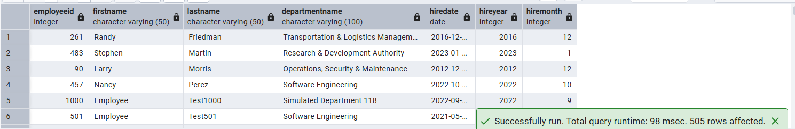


**השוואת יעילות (Q3):**  
מבחינה תכנונית וכללית במערכות מסדי נתונים, **`NOT EXISTS` (צורה ב׳) עדיפה ובטוחה יותר**: המתכנן של PostgreSQL ממיר אותה ל־**Hash Anti Join**, שעוצר מיד במציאת הרשומה הראשונה לכל עובד (Short-circuit) ואינו מושפע מערכי `NULL` (בעוד `NOT IN` תחזיר 0 שורות אם תת־השאילתה תכיל `NULL`). כאשר קיים אינדקס על `(EmployeeID, WorkDate)`, `NOT EXISTS` מהירה משמעותית בטבלאות גדולות; ללא אינדקס ועל 500 מזהים בלבד, `Hashed SubPlan` של `NOT IN` עם `DISTINCT` סיים מעט מהר יותר (67ms מול 98ms).

---

### Q4 — ניצול תקציב מול שכר לפי מחלקה (מסך Departments)

**תיאור השאילתה:** מציגה לכל מחלקה את התקציב השנתי שלה, מספר העובדים, סך הוצאות השכר, השכר הממוצע, ואחוז תקציב המחלקה המנוצל לתשלום משכורות.
#### צורה א׳ — `JOIN` + `GROUP BY`:
```sql
SELECT
    d.DepartmentName,
    d.Budget,
    COUNT(e.EmployeeID)                                     AS EmployeeCount,
    ROUND(SUM(e.BaseSalary)::NUMERIC, 2)                    AS TotalSalary,
    ROUND(AVG(e.BaseSalary)::NUMERIC, 2)                    AS AvgSalary,
    ROUND((SUM(e.BaseSalary) / d.Budget * 100)::NUMERIC, 2) AS SalaryBudgetPct
FROM Department d
JOIN Employee e ON d.DepartmentID = e.DepartmentID
GROUP BY d.DepartmentID, d.DepartmentName, d.Budget
ORDER BY SalaryBudgetPct DESC;
```


**צילום תוצאה — עד 5 שורות (Q4 צורה א׳ — 101ms)**

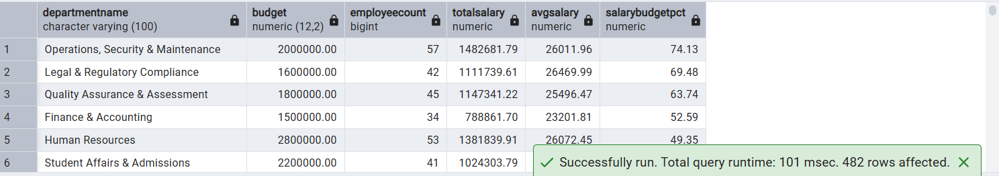


#### צורה ב׳ — פונקציות חלון (`OVER (PARTITION BY ...)`) + `DISTINCT`:
```sql
SELECT DISTINCT
    d.DepartmentName,
    d.Budget,
    COUNT(e.EmployeeID)      OVER (PARTITION BY d.DepartmentID) AS EmployeeCount,
    ROUND(SUM(e.BaseSalary)  OVER (PARTITION BY d.DepartmentID)::NUMERIC, 2) AS TotalSalary,
    ROUND(AVG(e.BaseSalary)  OVER (PARTITION BY d.DepartmentID)::NUMERIC, 2) AS AvgSalary,
    ROUND(
        (SUM(e.BaseSalary) OVER (PARTITION BY d.DepartmentID) / d.Budget * 100)::NUMERIC, 2
    ) AS SalaryBudgetPct
FROM Department d
JOIN Employee e ON d.DepartmentID = e.DepartmentID
ORDER BY SalaryBudgetPct DESC;
```


**צילום תוצאה — עד 5 שורות (Q4 צורה ב׳ — 87ms)**

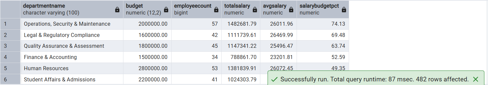


**השוואת יעילות (Q4):**  
**צורה א׳ (`GROUP BY`) יעילה יותר תאורטית ומבנית** לשאילתות סיכום: `HashAggregate` מצמצם את 1,000 שורות העובדים לשורה אחת לכל מחלקה במעבר יחיד. בצורה ב׳, פונקציות החלון (`WindowAgg`) ממיינות ומחשבות את האגרגציה על כל 1,000 שורות העובדים, ולאחר מכן נדרש שלב `Unique` / `HashAggregate` נוסף עבור ה־`DISTINCT` כדי להסיר שורות כפולות. פונקציות חלון מתאימות כאשר רוצים להציג באותה שורה גם את פרטי העובד הבודד וגם את ממוצע המחלקה שלו.

---

## 3. שאילתות SELECT נוספות (Q5–Q8)

### Q5 — סגל אקדמי קבוע (Tenured) שנקלט לפני 2015, ממוין לפי ותק (מסך Staff)

**תיאור השאילתה:** מציגה את חברי הסגל האקדמי הבכירים בעלי קביעות (`Tenured`) שנקלטו למכללה לפני שנת 2015, כולל תחום מחקר, פירוק תאריך הקליטה לשנה, חודש ויום, וחישוב שנות ותק (`AGE`).

```sql
SELECT
    e.EmployeeID,
    e.FirstName,
    e.LastName,
    d.DepartmentName,
    ac.ResearchField,
    ac.TenureStatus,
    EXTRACT(YEAR  FROM e.HireDate)::INT                     AS HireYear,
    EXTRACT(MONTH FROM e.HireDate)::INT                     AS HireMonth,
    EXTRACT(DAY   FROM e.HireDate)::INT                     AS HireDay,
    DATE_PART('year', AGE(CURRENT_DATE, e.HireDate))::INT   AS YearsOfService
FROM Employee     e
JOIN AcademicStaff ac ON e.EmployeeID   = ac.EmployeeID
JOIN Department    d  ON e.DepartmentID = d.DepartmentID
WHERE ac.TenureStatus = 'Tenured'
  AND EXTRACT(YEAR FROM e.HireDate) < 2015
ORDER BY e.HireDate ASC;
```


**צילום תוצאה — עד 5 שורות (Q5 — 71ms)**

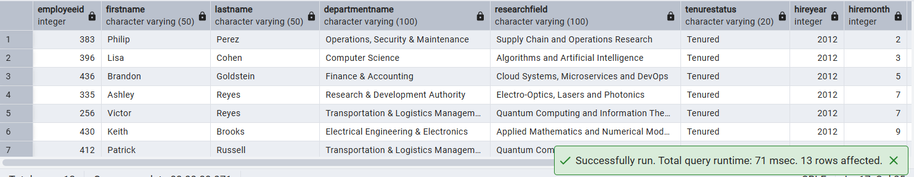


---

### Q6 — 5 הקורסים הפופולריים ביותר בפילוח לפי שנה וחודש (מסך Staff — דוח השתלמויות)

**תיאור השאילתה:** מאתרת באמצעות תת־שאילתה עם `LIMIT 5` את חמשת קורסי ההשתלמות המבוקשים ביותר בכל הזמנים, ומציגה עבורם פילוח של מספר ההשלמות לפי שנה וחודש.

```sql
SELECT
    tc.CourseName,
    tc.ProviderName,
    EXTRACT(YEAR FROM et.CompletionDate)::INT  AS CompletionYear,
    EXTRACT(MONTH FROM et.CompletionDate)::INT AS CompletionMonth,
    COUNT(*)                                   AS CompletionCount
FROM Employee_Training et
JOIN TrainingCourse tc ON et.CourseID = tc.CourseID
GROUP BY tc.CourseID, tc.CourseName, tc.ProviderName,
         EXTRACT(YEAR  FROM et.CompletionDate),
         EXTRACT(MONTH FROM et.CompletionDate)
HAVING tc.CourseID IN (
    SELECT CourseID
    FROM Employee_Training
    GROUP BY CourseID
    ORDER BY COUNT(*) DESC
    LIMIT 5
)
ORDER BY CompletionCount DESC, CompletionYear, CompletionMonth;
```


**צילום תוצאה — עד 5 שורות (Q6 — 109ms)**

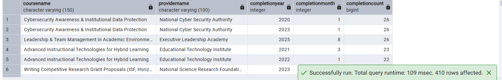


---

### Q7 — עובדים שממוצע המשמרת שלהם ב־2026 גבוה בלפחות רבע שעה מממוצע המכללה (מסך Attendance)

**תיאור השאילתה:** מחשבת את אורך המשמרת הממוצע בשעות לכל עובד בשנת 2026 מתוך הפרש שעות הכניסה והיציאה, ומסננת באמצעות תת־שאילתה ב־`HAVING` עובדים שממוצע המשמרת שלהם גבוה בלפחות 15 דקות (0.25 שעה) מהממוצע הכלל־מכללתי ב־2026.

```sql
SELECT
    e.EmployeeID,
    e.FirstName,
    e.LastName,
    d.DepartmentName,
    COUNT(a.RecordID)                        AS ShiftCount,
    ROUND(
        AVG(
            EXTRACT(EPOCH FROM (a.ClockOutTime - a.ClockInTime)) / 3600.0
        )::NUMERIC, 2
    )                                        AS AvgShiftHours,
    EXTRACT(YEAR FROM MIN(a.WorkDate))::INT  AS YearRecorded
FROM AttendanceRecord a
JOIN Employee   e ON a.EmployeeID   = e.EmployeeID
JOIN Department d ON e.DepartmentID = d.DepartmentID
WHERE EXTRACT(YEAR FROM a.WorkDate) = 2026
GROUP BY e.EmployeeID, e.FirstName, e.LastName, d.DepartmentName
HAVING AVG(
    EXTRACT(EPOCH FROM (a.ClockOutTime - a.ClockInTime)) / 3600.0
) > (
    SELECT AVG(EXTRACT(EPOCH FROM (ClockOutTime - ClockInTime)) / 3600.0) + 0.25
    FROM AttendanceRecord
    WHERE EXTRACT(YEAR FROM WorkDate) = 2026
)
ORDER BY AvgShiftHours DESC;
```


**צילום תוצאה — עד 5 שורות (Q7 — 85ms)**

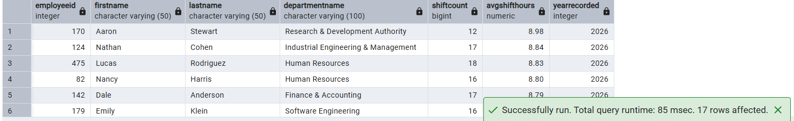


---

### Q8 — מנהלים בכירים ומספר הכפופים להם באותה מחלקה (מסך Departments)

**תיאור השאילתה:** מצרפת את טבלת הסגל המנהלי לעצמה דרך טבלת העובדים והמחלקות, ומציגה לכל מנהל בכיר (`Director` או `Head of Administration`) שיש לו מעל 5 כפופים באותה מחלקה את מספר הכפופים ואת תאריכי הקליטה המוקדם והמאוחר ביותר של כפופיו.
```sql
SELECT
    mgr.EmployeeID                              AS ManagerID,
    mgr_e.FirstName || ' ' || mgr_e.LastName   AS ManagerName,
    d.DepartmentName,
    mgr.ManagementLevel,
    COUNT(sub.EmployeeID)                       AS SubordinateCount,
    MIN(e_sub.HireDate)                         AS EarliestSubordinateHireDate,
    MAX(e_sub.HireDate)                         AS LatestSubordinateHireDate
FROM AdministrativeStaff mgr
JOIN Employee mgr_e ON mgr.EmployeeID     = mgr_e.EmployeeID
JOIN Department d   ON mgr_e.DepartmentID = d.DepartmentID
JOIN AdministrativeStaff sub ON sub.EmployeeID <> mgr.EmployeeID
    AND sub.ManagementLevel NOT IN ('Director','Head of Administration')
JOIN Employee e_sub ON sub.EmployeeID = e_sub.EmployeeID
    AND e_sub.DepartmentID = mgr_e.DepartmentID
WHERE mgr.ManagementLevel IN ('Director','Head of Administration')
GROUP BY mgr.EmployeeID, mgr_e.FirstName, mgr_e.LastName,
         d.DepartmentName, mgr.ManagementLevel
HAVING COUNT(sub.EmployeeID) > 5
ORDER BY SubordinateCount DESC;
```


**צילום תוצאה — עד 5 שורות (Q8 — 85ms)**

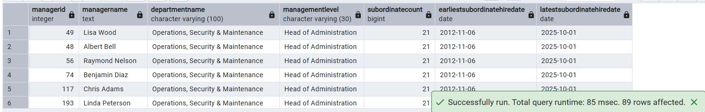


---

## 4. שאילתות DELETE (D1–D3)

### D1 — מחיקת רשומות נוכחות מרבעון 1/2025 של סגל אקדמי לא קבוע (מסך Attendance)
**תיאור:** ניקוי ארכיון נוכחות — מוחק רשומות נוכחות מהרבעון הראשון של שנת 2025 (חודשים ינואר–מרץ) עבור מרצים מן החוץ ומרצים אורחים (`Adjunct`, `Visiting Professor`). נמחקו **535 רשומות**.

```sql
DELETE FROM AttendanceRecord
WHERE EXTRACT(YEAR  FROM WorkDate) = 2025
  AND EXTRACT(MONTH FROM WorkDate) BETWEEN 1 AND 3
  AND EmployeeID IN (
      SELECT EmployeeID
      FROM AcademicStaff
      WHERE TenureStatus IN ('Adjunct', 'Visiting Professor')
  );
```


**תוצאת ההרצה (535 שורות נמחקו)**

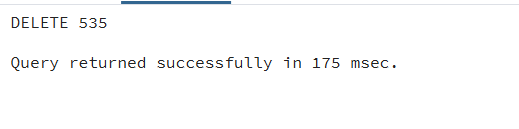


**מצב הטבלה לפני המחיקה**

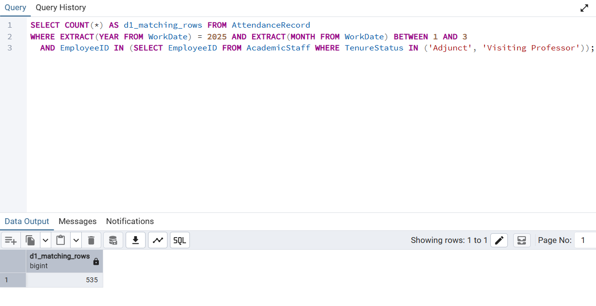

**מצב הטבלה אחרי המחיקה**

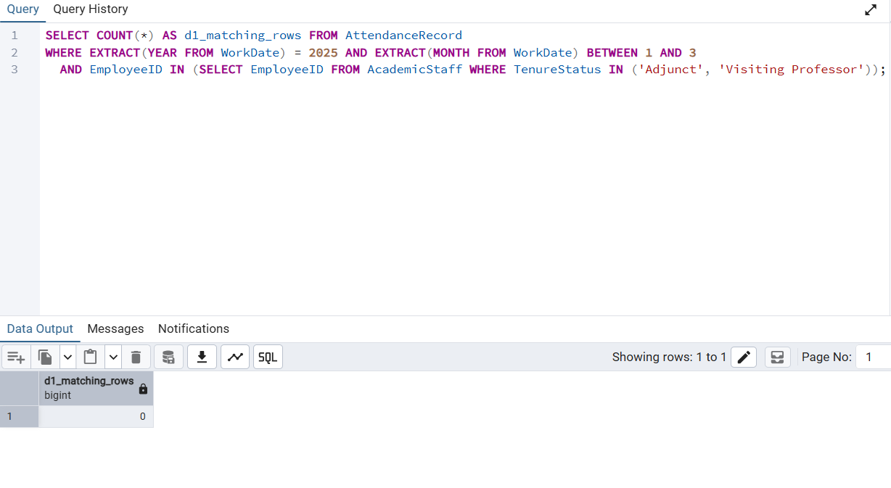


---

### D2 — מחיקת רישומי השתלמות ישנים של קורס שהופסק (מסך Staff)
**תיאור:** מוחק רשומות השתלמות של קורס מספר 218 שהושלמו לפני שנת 2023 בעקבות סיום ההתקשרות עם ספק הקורס. נמחקו **530 רשומות**.

```sql
DELETE FROM Employee_Training
WHERE CourseID = 218
  AND EXTRACT(YEAR FROM CompletionDate) < 2023;
```

### D3 — ניקוי רשומות השתלמות שתאריך סיומן קדם לתאריך קליטת העובד (מסך Staff)
**תיאור:** בקרת איכות נתונים — מוחק רשומות בטבלת `Employee_Training` שבהן תאריך השלמת הקורס (`CompletionDate`) מוקדם מתאריך תחילת העבודה של העובד במכללה (`HireDate`). נמחקו **4,186 רשומות** שגויות.

```sql
DELETE FROM Employee_Training et
USING Employee e
WHERE et.EmployeeID = e.EmployeeID
  AND et.CompletionDate < e.HireDate;
```


**צילום הרצת D2 ו־D3**

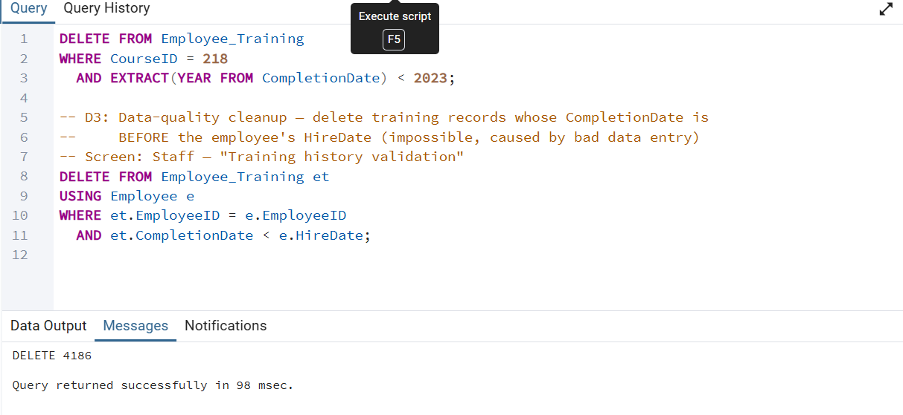


**מצב לפני D2**


**מצב אחרי D2**


**מצב לפני D3**

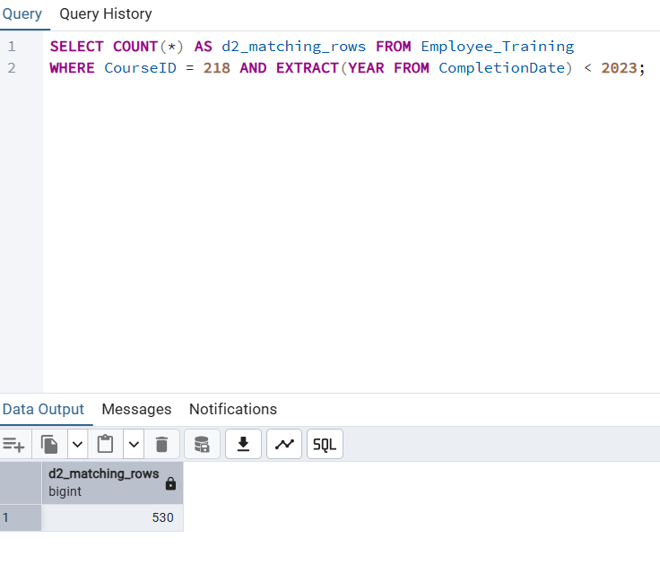

**מצב אחרי D3**

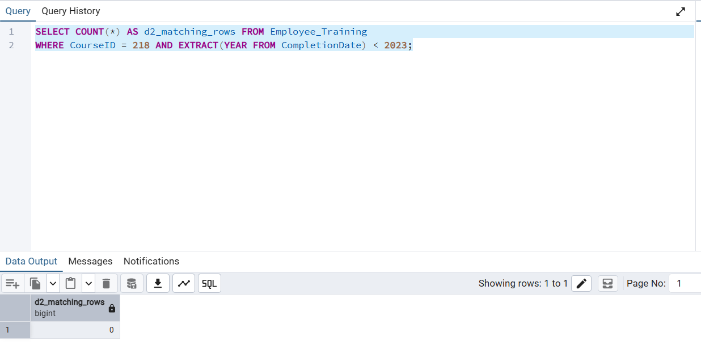

---

## 5. שאילתות UPDATE (U1–U3)

### U1 — העלאת שכר של 5% לכל הסגל האקדמי בעל קביעות (מסך Staff)
**תיאור:** מעדכן את שכר הבסיס (`BaseSalary`) בתוספת של 5% עבור כל העובדים המופיעים בטבלת `AcademicStaff` בסטטוס `Tenured`. עודכנו **178 עובדים**.

```sql
UPDATE Employee
SET BaseSalary = ROUND((BaseSalary * 1.05)::NUMERIC, 2)
WHERE EmployeeID IN (
    SELECT EmployeeID
    FROM AcademicStaff
    WHERE TenureStatus = 'Tenured'
);
```


**צילום הרצת U1 (178 שורות עודכנו)**

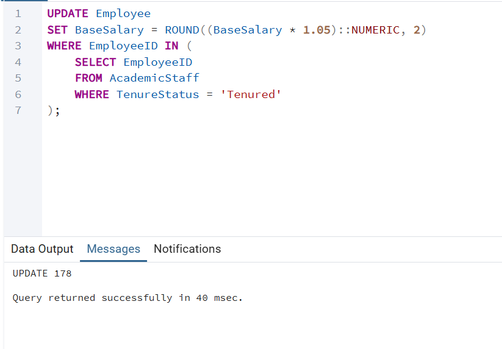


**מצב לפני העדכון (U1)**

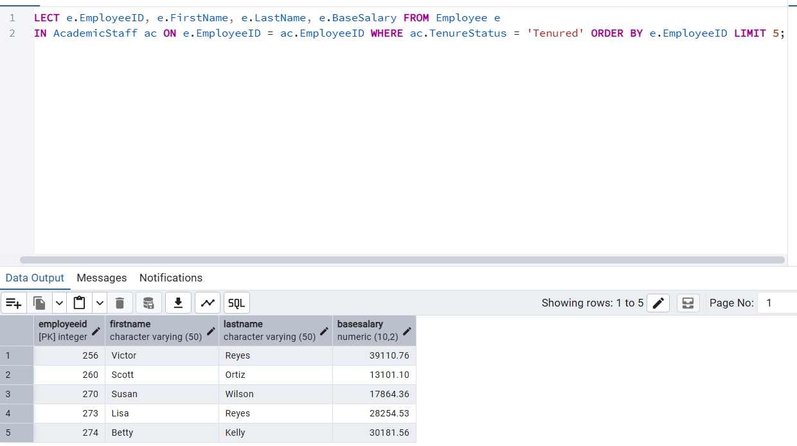

**מצב אחרי העדכון (U1)**

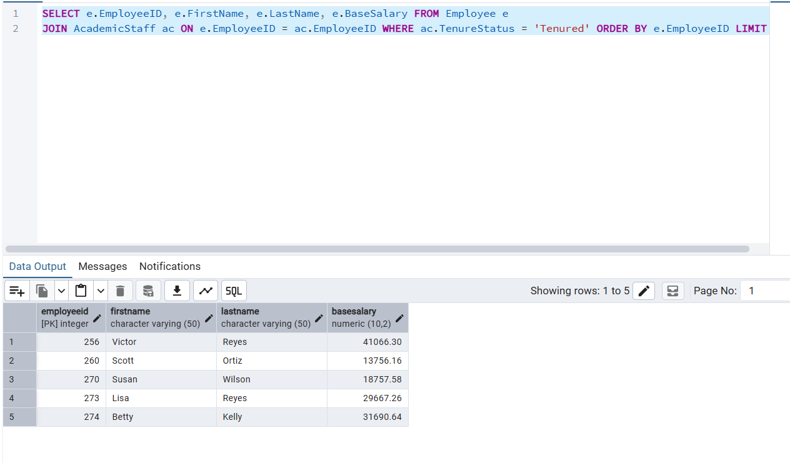


---

### U2 — קידום עובדים מנהליים מדרג Mid ל־Senior (מסך Staff)
**תיאור:** מקדם לדרג `Senior` עובדים מנהליים בדרג `Mid` שנקלטו למכללה לפני שנת 2020 ושכר הבסיס שלהם הוא לפחות 8,000 ₪. עודכנו **15 עובדים**.

```sql
UPDATE AdministrativeStaff
SET ManagementLevel = 'Senior'
WHERE ManagementLevel = 'Mid'
  AND EmployeeID IN (
      SELECT EmployeeID
      FROM Employee
      WHERE EXTRACT(YEAR FROM HireDate) < 2020
        AND BaseSalary >= 8000
  );
```


**צילום הרצת U2 (15 שורות עודכנו)**

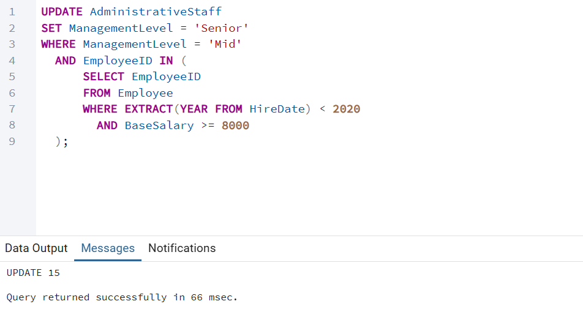


**מצב לפני העדכון (U2)**

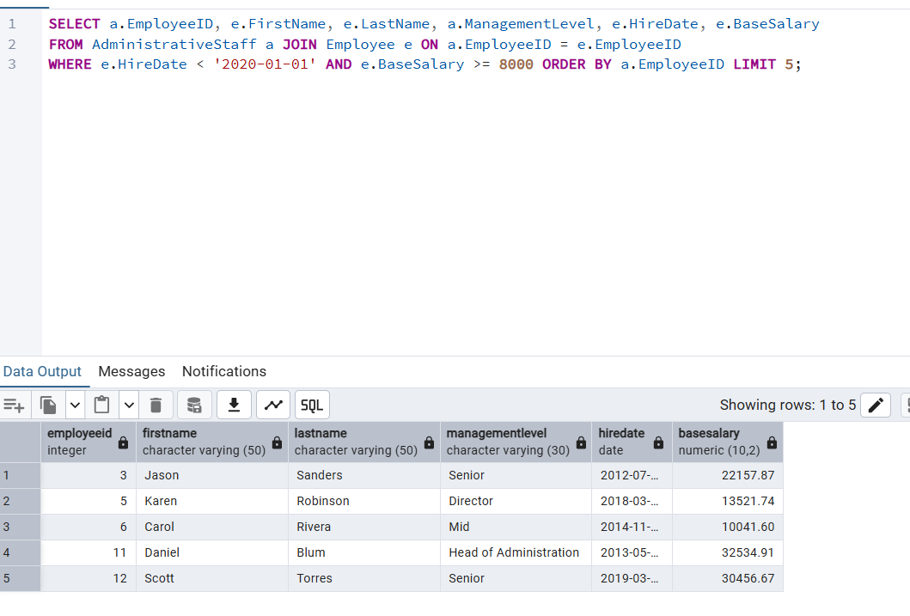

**מצב אחרי העדכון (U2)**

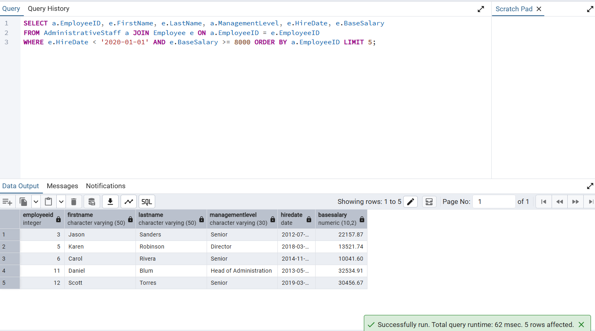


---

### U3 — הגדלת תקציב ב־8% למחלקות שבהן סך השכר עולה על 70% מהתקציב (מסך Departments)
**תיאור:** מאתר באמצעות תת־שאילתה מקובצת (`GROUP BY ... HAVING`) מחלקות שבהן סך משכורות העובדים עולה על 70% מתקציב המחלקה, ומגדיל את תקציבן ב־8%. עודכנה **מחלקה אחת** (Operations, Security & Maintenance).

```sql
UPDATE Department
SET Budget = ROUND((Budget * 1.08)::NUMERIC, 2)
WHERE DepartmentID IN (
    SELECT e.DepartmentID
    FROM Employee e
    JOIN Department d ON e.DepartmentID = d.DepartmentID
    GROUP BY e.DepartmentID, d.Budget
    HAVING SUM(e.BaseSalary) > d.Budget * 0.70
);
```


**צילום הרצת U3 (שורה אחת עודכנה)**

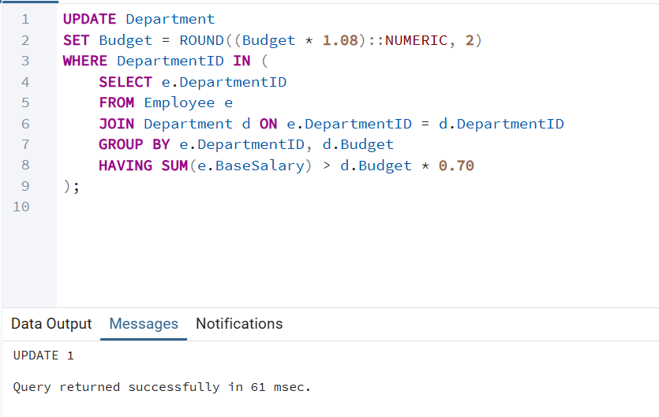


**מצב לפני העדכון (U3)**

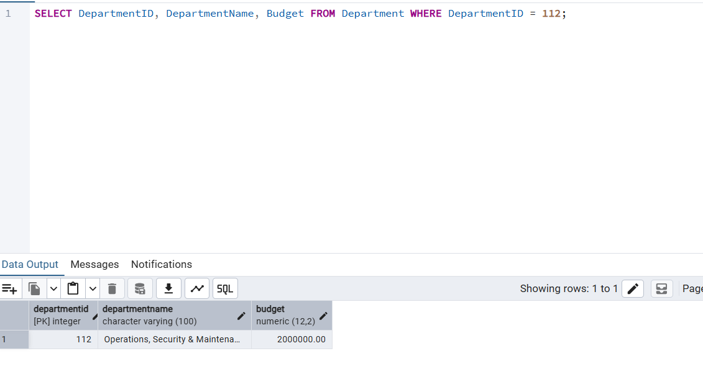

**מצב אחרי העדכון (U3)**

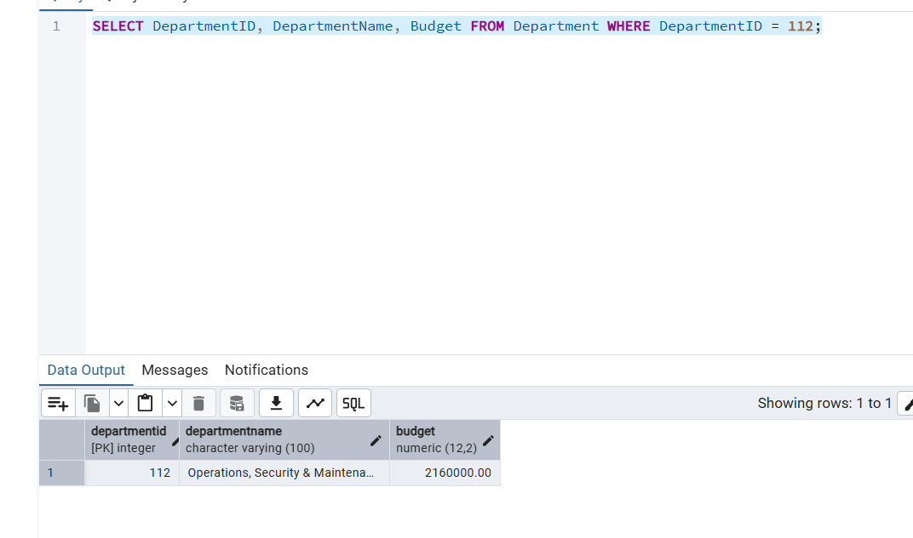


---

## 6. טרנזקציות: ROLLBACK ו־COMMIT

קוד מלא: [`RollbackCommit.sql`](RollbackCommit.sql)

### א. הדגמת ROLLBACK
פתחנו טרנזקציה (`BEGIN`), עדכנו את שכר עובד מס׳ 1 ל־`99999.99`, הצגנו את מצב בסיס הנתונים לאחר העדכון, ולאחר מכן ביצענו `ROLLBACK` והצגנו שהשכר חזר לערכו המקורי.

```sql
SELECT EmployeeID, FirstName, LastName, BaseSalary FROM Employee WHERE EmployeeID = 1;
BEGIN;
UPDATE Employee SET BaseSalary = 99999.99 WHERE EmployeeID = 1;
SELECT EmployeeID, FirstName, LastName, BaseSalary FROM Employee WHERE EmployeeID = 1;
ROLLBACK;
SELECT EmployeeID, FirstName, LastName, BaseSalary FROM Employee WHERE EmployeeID = 1;
```


**לפני העדכון**

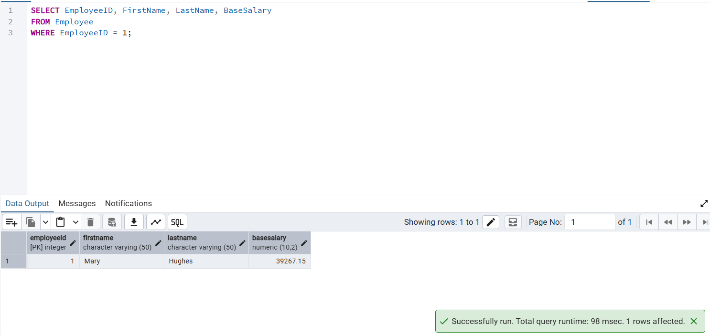

**אחרי העדכון (בתוך הטרנזקציה)**

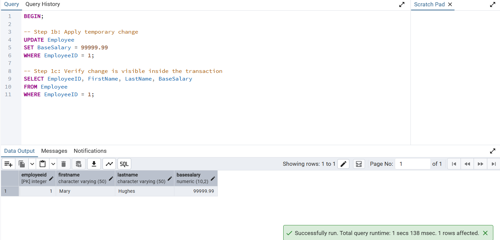

**אחרי ROLLBACK (חזר לקדמותו)**

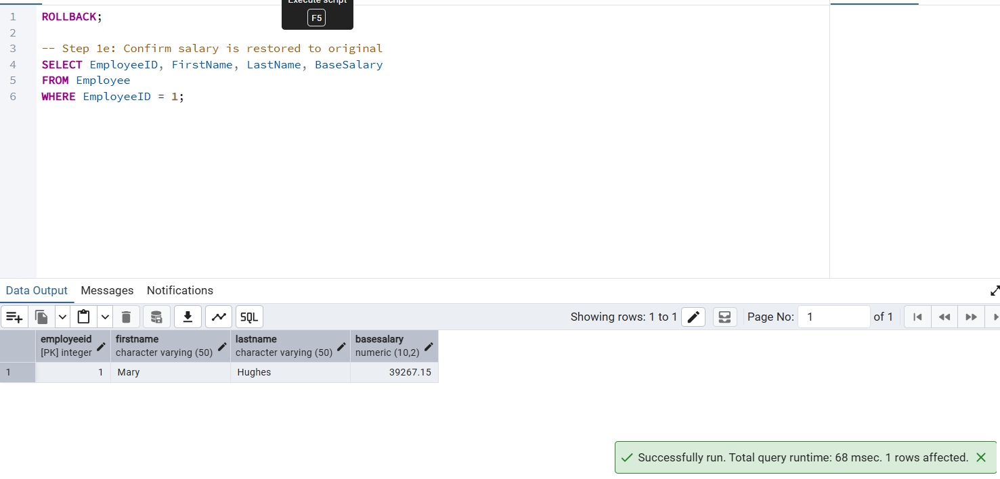


### ב. הדגמת COMMIT
פתחנו טרנזקציה (`BEGIN`), הגדלנו את תקציב מחלקה 101 ב־10%, הצגנו את מצב הטבלה לאחר העדכון, ביצענו `COMMIT`, והצגנו שהשינוי נשמר בבסיס הנתונים לצמיתות.

```sql
SELECT DepartmentID, DepartmentName, Budget FROM Department WHERE DepartmentID = 101;
BEGIN;
UPDATE Department SET Budget = ROUND((Budget * 1.10)::NUMERIC, 2) WHERE DepartmentID = 101;
SELECT DepartmentID, DepartmentName, Budget FROM Department WHERE DepartmentID = 101;
COMMIT;
SELECT DepartmentID, DepartmentName, Budget FROM Department WHERE DepartmentID = 101;
```


**לפני העדכון**

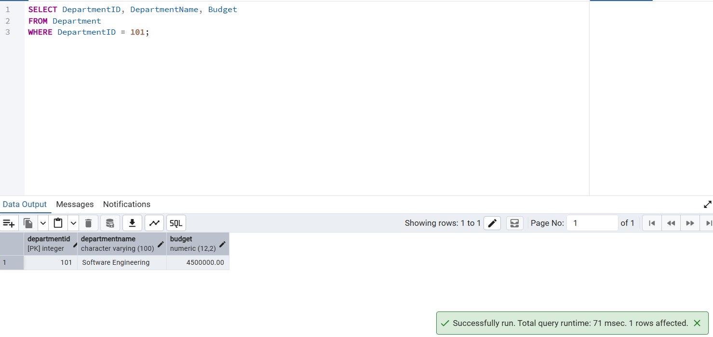

**אחרי העדכון (בתוך הטרנזקציה)**

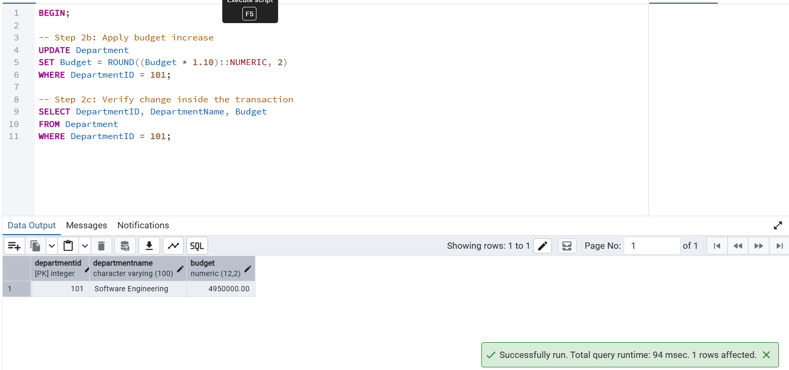

**אחרי COMMIT (נשמר לצמיתות)**

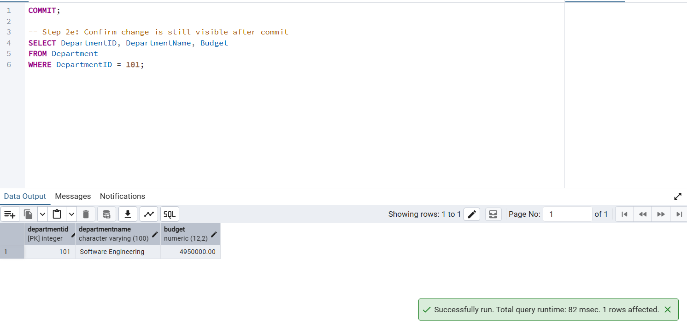


---

## 7. אילוצים (Constraints)

קוד מלא: [`Constraints.sql`](Constraints.sql) — שלושת האילוצים נוספו באמצעות `ALTER TABLE`.

| # | שם האילוץ | טבלה | פקודת `ALTER TABLE` | מוטיבציה ותועלת |
|---|---|---|---|---|
| **C1** | `chk_min_salary` | `Employee` | `ALTER TABLE Employee ADD CONSTRAINT chk_min_salary CHECK (BaseSalary >= 5000);` | מונע הזנת שכר שלילי, אפס או נמוך משכר המינימום במכללה, ושומר על אמינות חישובי השכר והתקציב. |
| **C2** | `chk_reasonable_clockin` | `AttendanceRecord` | `ALTER TABLE AttendanceRecord ADD CONSTRAINT chk_reasonable_clockin CHECK (ClockInTime >= '05:00:00' AND ClockInTime <= '16:00:00');` | מונע דיווחי כניסה בשעות לא סבירות (למשל 03:00 לפנות בוקר) כתוצאה מטעות הקלדה, ושומר על דיוק דוחות השעות. |
| **C3** | `uq_employee_workdate` | `AttendanceRecord` | `ALTER TABLE AttendanceRecord ADD CONSTRAINT uq_employee_workdate UNIQUE (EmployeeID, WorkDate);` | מבטיח שעובד לא יוכל לדווח שתי רשומות נוכחות באותו תאריך, ויוצר אוטומטית אינדקס B-Tree משולב על `(EmployeeID, WorkDate)`. |

### הרצת פקודות `ALTER TABLE` להוספת האילוצים:
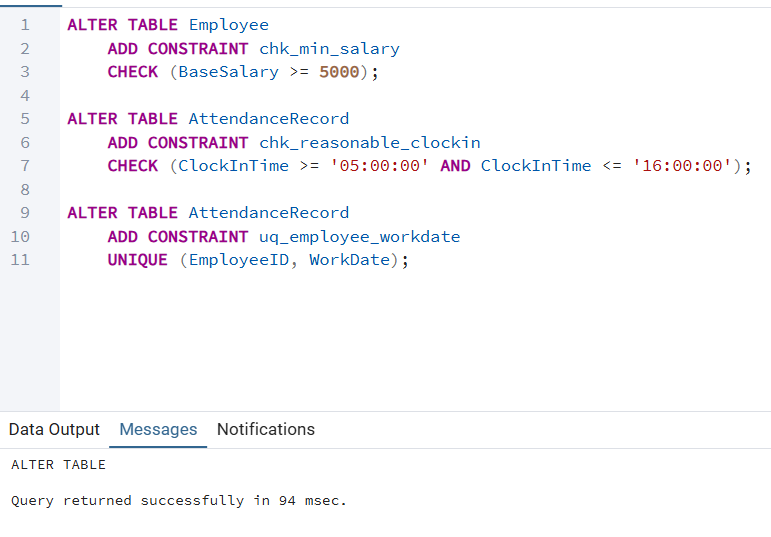

### ניסיונות הכנסת נתונים הסותרים את האילוצים (שגיאות הרצה):


**הפרת אילוץ C1 (`BaseSalary = 3000`)**

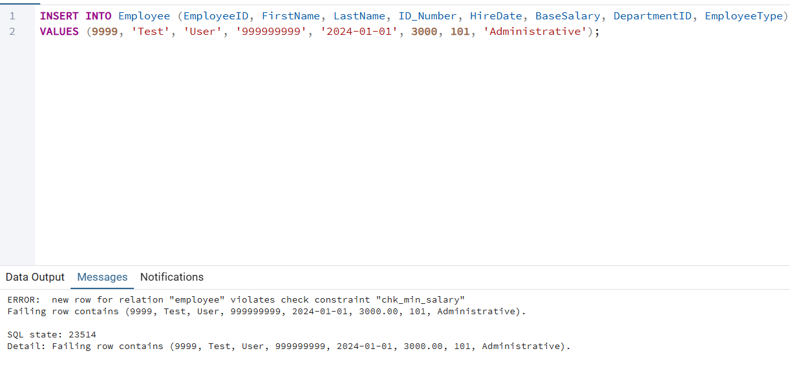

**הפרת אילוץ C2 (`ClockInTime = '03:00:00'`)**

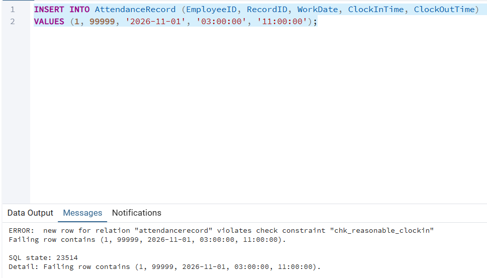

**הפרת אילוץ C3 (תאריך כפול לאותו עובד)**

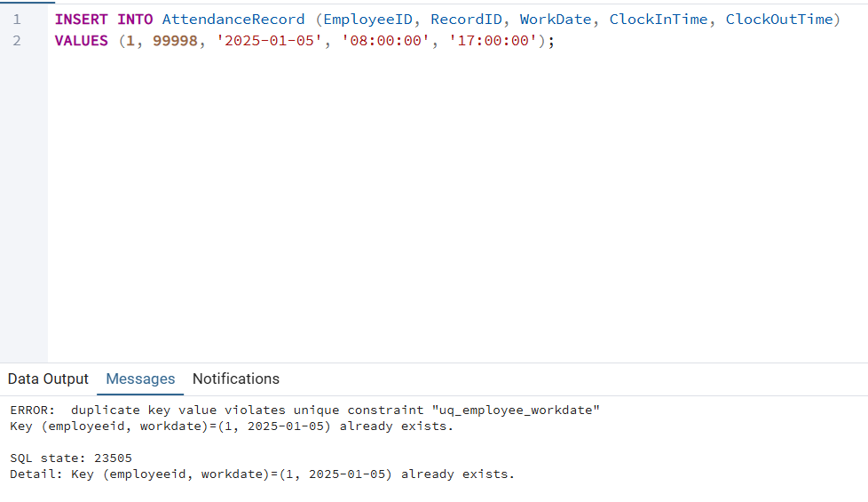


---

## 8. אינדקסים (Indexes)

קוד מלא: [`Index.sql`](Index.sql) — זמני הריצה ותוכניות הביצוע נבדקו באמצעות `EXPLAIN ANALYZE` לפני ואחרי יצירת כל אינדקס.

| # | שם האינדקס | הגדרת האינדקס | מוטיבציה | לפני הוספת האינדקס | אחרי הוספת האינדקס |
|---|---|---|---|---|---|
| **I1** | `idx_employee_departmentid` | `CREATE INDEX idx_employee_departmentid ON Employee(DepartmentID);` | עמודת מפתח זר המשמשת בצירופים ובסינונים לפי מחלקה (Q1, Q2, Q4, Q7, Q8). | **0.387 ms** (`Seq Scan`, cost=`35.32`, הסרת 947 שורות בסינון) | **0.945 ms** (`Bitmap Index Scan`, cost ירד ל־`28.17`) |
| **I2** | `idx_attendance_workdate` | `CREATE INDEX idx_attendance_workdate ON AttendanceRecord(WorkDate);` | טבלה בת 20,000 שורות; מאיץ סינון לפי טווחי תאריכים (Q1, Q3, Q7). | **2.245 ms** (`Seq Scan`, cost=`439.97`, הסרת 13,850 שורות) | **0.757 ms** (`Bitmap Index Scan`, cost=`310.33` — **שיפור של פי 3**) |
| **I3** | `idx_training_completiondate` | `CREATE INDEX idx_training_completiondate ON Employee_Training(CompletionDate);` | טבלה בת 20,000 שורות; משמשת לשאילתות ולדוחות לפי תאריך השלמת קורס (Q2, Q6, D2, D3). | **15.982 ms** (`Seq Scan` + `HashAggregate`, Planning=`2.073 ms`) | **3.496 ms** (`Seq Scan` + `HashAggregate`, Planning=`0.239 ms`) |

### צילומי הרצה של `EXPLAIN ANALYZE` — לפני ואחרי כל אינדקס:

#### אינדקס 1 (`idx_employee_departmentid` על `Employee.DepartmentID`):

**לפני יצירת האינדקס (`Seq Scan`)**

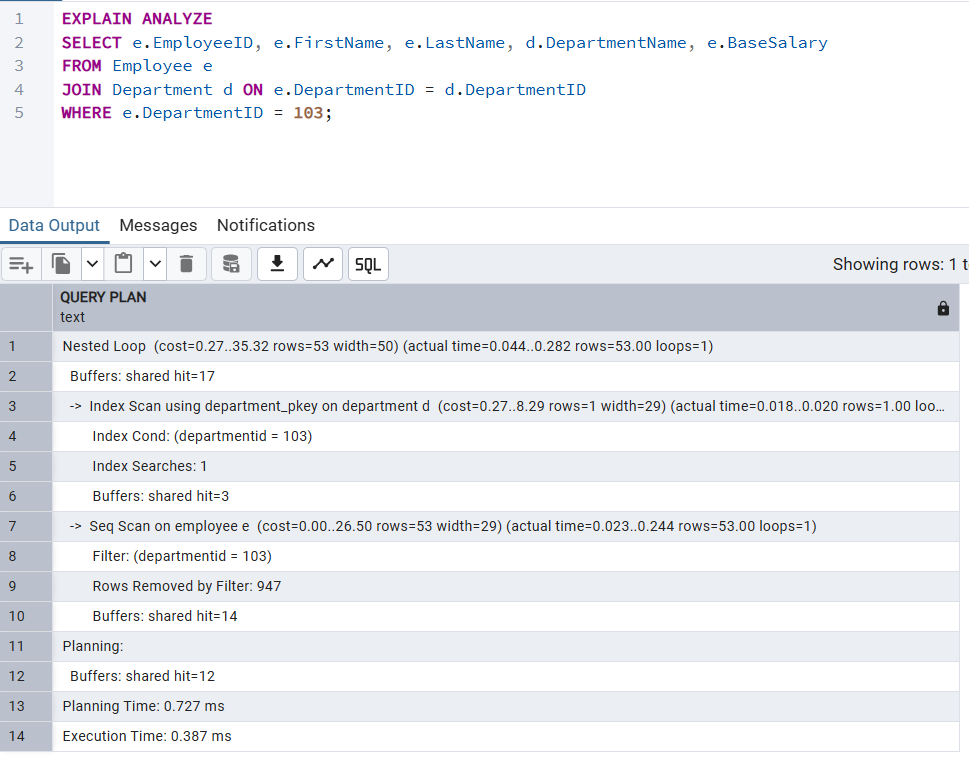

**אחרי יצירת האינדקס (`Bitmap Index Scan`)**

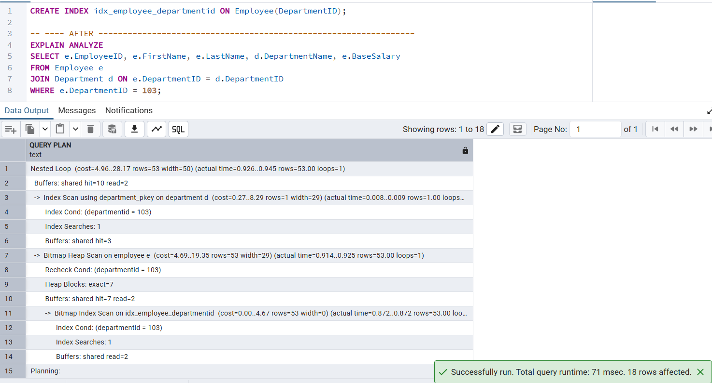


#### אינדקס 2 (`idx_attendance_workdate` על `AttendanceRecord.WorkDate`):

**לפני יצירת האינדקס (`2.245 ms` — `Seq Scan`)**

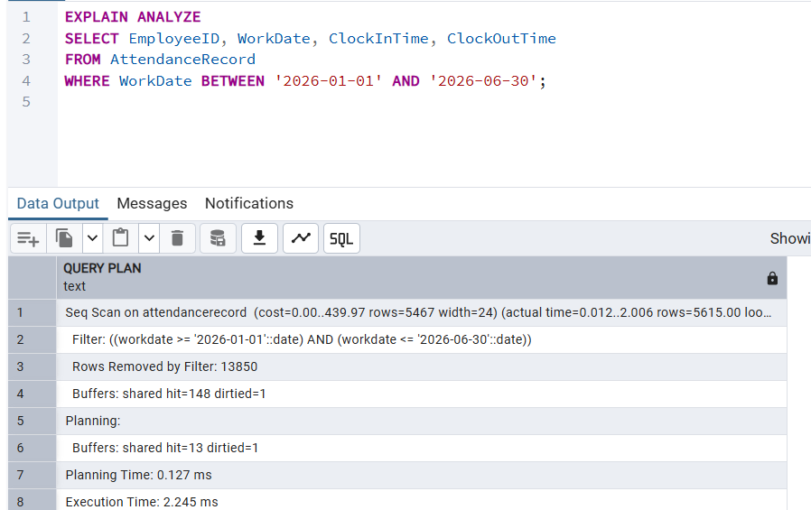

**אחרי יצירת האינדקס (`0.757 ms` — `Bitmap Index Scan`)**

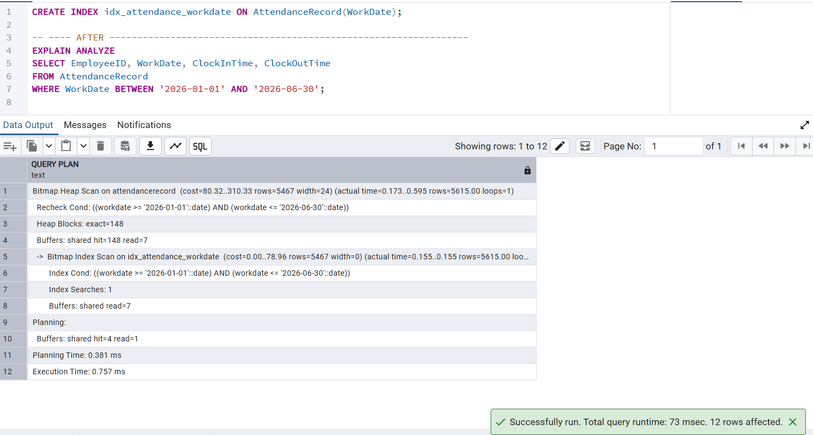


#### אינדקס 3 (`idx_training_completiondate` על `Employee_Training.CompletionDate`):

**לפני יצירת האינדקס (`15.982 ms`)**

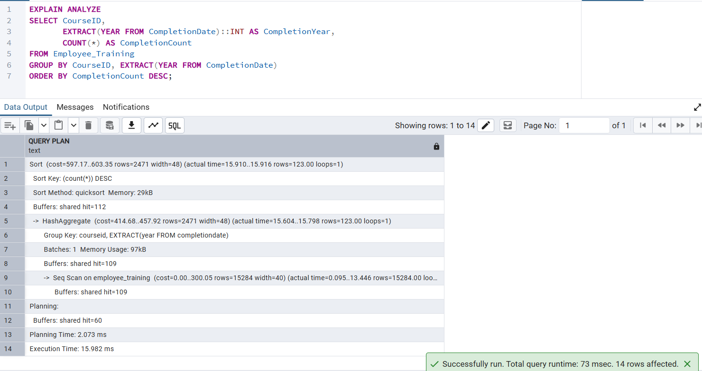

**אחרי יצירת האינדקס (`3.496 ms`)**

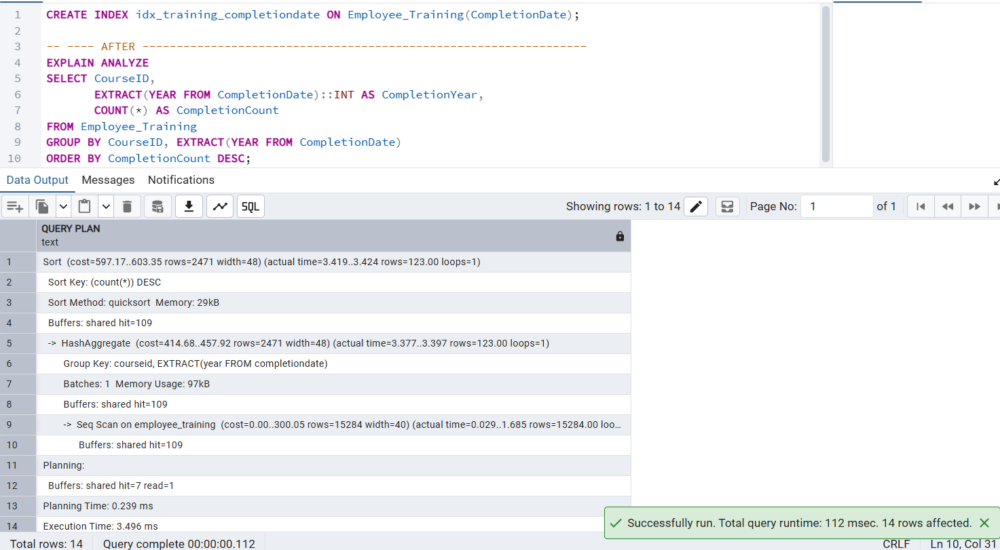


**הסבר התוצאות:**
- **אינדקס I1 (`Employee.DepartmentID`):** לפני הוספת האינדקס מתכנן השאילתות ביצע **Seq Scan** על כל 1,000 שורות טבלת `Employee` וסינן החוצה 947 שורות (`cost=35.32`). לאחר הוספת האינדקס המתכנן עבר ל־**Bitmap Index Scan + Bitmap Heap Scan** על 53 השורות הרלוונטיות בלבד והוריד את העלות החזויה ל־`28.17`. בריצה הראשונה מיד לאחר יצירת האינדקס נדרשה קריאה ראשונית של שני בלוקים מהדיסק (`read=2`) ולכן הזמן בפועל היה 0.945ms לעומת 0.387ms מהזיכרון המטמון בטבלה קטנה של 14 דפים בלבד. בטבלאות גדולות יותר החיסכון של ה־Bitmap Index Scan משמעותי מאוד.
- **אינדקס I2 (`AttendanceRecord.WorkDate`):** מדגים בצורה מובהקת את התועלת של אינדקס B-Tree בטבלה גדולה (כ־20,000 שורות): לפני האינדקס בוצע **Seq Scan** שקרא וסרק את כל הטבלה וסינן 13,850 שורות ב־**2.245 ms** (`cost=439.97`). לאחר הוספת האינדקס המתכנן עבר ל־**Bitmap Index Scan** שקפץ ישירות לטווח התאריכים המבוקש, וזמן הריצה צנח ל־**0.757 ms** — **שיפור של פי 3 במהירות הריצה**.
- **אינדקס I3 (`Employee_Training.CompletionDate`):** השאילתה מבצעת קיבוץ (`GROUP BY EXTRACT(YEAR FROM CompletionDate)`) על **כל** שורות הטבלה ללא תנאי `WHERE`. מאחר שיש לקרוא 100% מהשורות בכל מקרה, המתכנן של PostgreSQL בוחר בחוכמה להמשיך ב־**Seq Scan** (קריאה רציפה של 109 בלוקים מהירה יותר מגישה אקראית דרך אינדקס לכל שורות הטבלה). זמן הריצה התקצר מ־**15.982 ms** ל־**3.496 ms** בזכות הימצאות כל 109 הדפים בזיכרון המטמון (`shared hit=109`) ועדכון סטטיסטיקות הטבלה בעת בניית האינדקס. כאשר מוסיפים תנאי סינון על טווח תאריכים (כמו ב־Q2 או D2), המתכנן משתמש באינדקס זה לביצוע Index Scan מהיר.

---

## 9. קבצי השלב

| קובץ | תיאור |
|---|---|
| [`Queries.sql`](Queries.sql) | 8 שאילתות SELECT (4 בשתי צורות), 3 שאילתות DELETE, ו־3 שאילתות UPDATE |
| [`Constraints.sql`](Constraints.sql) | 3 אילוצים חדשים באמצעות `ALTER TABLE` + דוגמאות הפרה |
| [`RollbackCommit.sql`](RollbackCommit.sql) | הדגמת טרנזקציות עם `ROLLBACK` ו־`COMMIT` |
| [`Index.sql`](Index.sql) | 3 אינדקסים ובדיקת זמני ריצה לפני/אחרי באמצעות `EXPLAIN ANALYZE` |
| [`backup2`](backup2) | קובץ גיבוי מעודכן של בסיס הנתונים לשלב ב׳ |
| [`README.md`](README.md) | דוח מפורט זה לשלב ב׳ |
